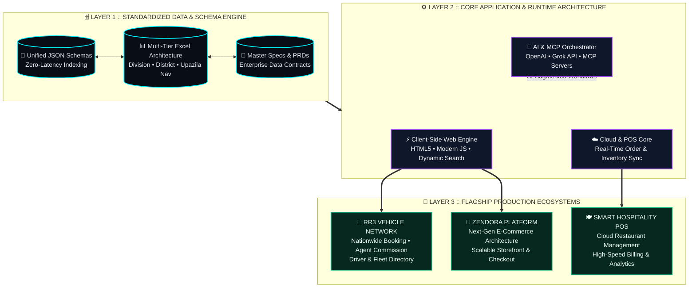

<div align="center">

<!-- ═══════════════════════════════════════════════════════════════════════════════ -->
<!-- 🚀 LAYER 01 :: CYBER-OS HUD HEADER & ANIMATED NEURAL BANNER                     -->
<!-- ═══════════════════════════════════════════════════════════════════════════════ -->


<!-- ⌨️ DYNAMIC TERMINAL BOOT SEQUENCE -->
<a href="https://github.com/rubayet9">
  
</a>

<br/>

<!-- 🛰️ LIVE TELEMETRY STATUS BAR -->
<p align="center">
  
  
  
  
  
</p>

</div>

---

<!-- ═══════════════════════════════════════════════════════════════════════════════ -->
<!-- 🧠 LAYER 02 :: BENTO-GRID COMMAND DECK (TERMINAL DOSSIER + CAPABILITY GAUGES)   -->
<!-- ═══════════════════════════════════════════════════════════════════════════════ -->

## ⚡ `// 01. NEURAL_COMMAND_DECK :: SYSTEM_DOSSIER`

<table width="100%">
<tr>
<td width="54%" valign="top">

### 💻 `root@rubayet9:~# cat system_specs.json`

```json
{
  "architect": "Rubayet Khan",
  "handle": "@rubayet9",
  "designation": "Software Architect & Platform Engineer",
  "core_philosophy": "Zero-Bloat, High-Speed Execution",
  "specializations": [
    "Lightweight Static & Client-Side Web Engines",
    "Standardized Nationwide Data Schemas (JSON/Excel)",
    "E-Commerce, Mobility Networks & Cloud POS",
    "AI Coding Agents, MCP Servers & LLM APIs"
  ],
  "active_ecosystems": [
    "RR3 Rent-A-Car & Nationwide Vehicle Network",
    "Zendora Next-Gen E-Commerce Platform",
    "AI/MCP Local & Cloud Workflow Automation"
  ],
  "runtime_status": "BUILDING_HIGH_SCALE_SYSTEMS"
}
```

</td>
<td width="46%" valign="top">

### 🎛️ `// ARCHITECTURAL_TELEMETRY`

```text
┌──────────────────────────────────────────────┐
│ ⚡ SYSTEM & PLATFORM ARCHITECTURE             │
│ ███████████████████████████████████░░  95%   │
│                                              │
│ 🗄️ DATA SCHEMAS & DIRECTORY ENGINES          │
│ ██████████████████████████████████░░░  92%   │
│                                              │
│ 🌐 LIGHTWEIGHT WEB & UI ENGINEERING          │
│ █████████████████████████████████░░░░  90%   │
│                                              │
│ 🤖 AI AGENTS, MCP & API ORCHESTRATION        │
│ ███████████████████████████████░░░░░░  88%   │
│                                              │
│ 📋 PRODUCT SPECS (PRD) & SYSTEM DESIGN       │
│ ██████████████████████████████████░░░  94%   │
└──────────────────────────────────────────────┘
```

> **Architectural Directive:** Eliminate unnecessary backend overhead where fast, deterministic client-side engines and structured JSON/Data schemas deliver instant performance at nationwide scale.

</td>
</tr>
</table>

---

<!-- ═══════════════════════════════════════════════════════════════════════════════ -->
<!-- 🗺️ LAYER 03 :: NATIVE MERMAID.JS LIVE ARCHITECTURE BLUEPRINT                    -->
<!-- ═══════════════════════════════════════════════════════════════════════════════ -->

## 🗺️ `// 02. LIVE_SYSTEM_ARCHITECTURE :: ECOSYSTEM_BLUEPRINT`

> *Rendered natively via GitHub Mermaid Engine — illustrating how my data schemas, core platforms, and AI pipelines interconnect in production:*



---

<!-- ═══════════════════════════════════════════════════════════════════════════════ -->
<!-- 🏛️ LAYER 04 :: ENTERPRISE BENTO-GRID (FLAGSHIP ECOSYSTEMS)                      -->
<!-- ═══════════════════════════════════════════════════════════════════════════════ -->

## 🛰️ `// 03. ACTIVE_DIRECTIVES :: BENTO_ECOSYSTEM_GRID`

<table width="100%">
<tr>
<td width="50%" valign="top">

### 🚗 `RR3 RENT-A-CAR & VEHICLE NETWORK`
**Nationwide Mobility & Directory Ecosystem**
* **Architecture:** Engineered a high-speed, client-side static web & data platform covering all administrative divisions, districts, and upazilas of Bangladesh.
* **Core Modules:** Automated agent commission model, driver/owner fleet management, and unified Excel-to-JSON directory synchronization.
* **Impact:** Instantaneous search & filtering across nationwide transport nodes with zero backend latency.

`[HTML5]` `[JavaScript]` `[JSON Schema]` `[Advanced Excel]` `[Directory Engine]`  
**Status:** `██████████████████░░ ACTIVE PRODUCTION`

</td>
<td width="50%" valign="top">

### 🛒 `ZENDORA E-COMMERCE PLATFORM`
**Next-Gen Digital Commerce Architecture**
* **Architecture:** Designed from the ground up with a comprehensive **Master Specification Document** and **Product Requirements Document (PRD)**.
* **Core Modules:** Modular catalog indexing, frictionless cart/checkout state management, and responsive high-conversion UI architecture.
* **Impact:** Built for maximum scalability, clean data flow, and rapid deployment.

`[Web Platform]` `[System PRD]` `[State Management]` `[Modular UI]` `[JSON/API]`  
**Status:** `████████████████░░░░ CORE ARCHITECTURE`

</td>
</tr>
<tr>
<td width="50%" valign="top">

### 🤖 `AI AGENTS & MCP INFRASTRUCTURE`
**Next-Gen Developer Workflows & API Pipelines**
* **Architecture:** Local and cloud workflow orchestration integrating **Model Context Protocol (MCP)** servers with autonomous AI coding agents.
* **Core Modules:** Multi-model API integration (**OpenAI**, **Grok AI**), automated code synthesis, and structured data extraction pipelines.
* **Impact:** Accelerates software architecture, schema validation, and rapid prototyping by 10x.

`[MCP Servers]` `[OpenAI API]` `[Grok AI]` `[AI Agents]` `[Automation]`  
**Status:** `█████████████████░░░ CONTINUOUS R&D`

</td>
<td width="50%" valign="top">

### 🍽️ `CLOUD POS & ENTERPRISE DIRECTORIES`
**Hospitality Tech Stacks & Data Navigation Systems**
* **Architecture:** Cloud-ready restaurant management and Point-of-Sale (POS) system designs alongside button-driven spreadsheet/web data directories.
* **Core Modules:** Division/District/Upazila hierarchical navigation, dynamic search engines, and standardized data schemas.
* **Impact:** Bridges enterprise data organization with intuitive, zero-training user interfaces.

`[Cloud POS]` `[Data Modeling]` `[Dynamic Search]` `[UI/UX Systems]`  
**Status:** `████████████████░░░░ DEPLOYED SCHEMAS`

</td>
</tr>
</table>

---

<!-- ═══════════════════════════════════════════════════════════════════════════════ -->
<!-- 🛠️ LAYER 05 :: CATEGORIZED TECHNOLOGY & ARCHITECTURE MATRIX                     -->
<!-- ═══════════════════════════════════════════════════════════════════════════════ -->

## 🛠️ `// 04. TECH_ARSENAL :: MULTI-PILLAR_MATRIX`

<table width="100%">
<tr>
<th width="25%">🌐 Web & Client Engines</th>
<th width="25%">🗄️ Data & Schema Systems</th>
<th width="25%">🤖 AI, LLMs & MCP</th>
<th width="25%">📐 Architecture & Ops</th>
</tr>
<tr>
<td valign="top" align="center">

<br/>
<br/><br/>
<br/><br/>
<br/><br/>

<br/><br/>

</td>
<td valign="top" align="center">

<br/>
<br/><br/>
<br/><br/>
<br/><br/>

<br/><br/>

</td>
<td valign="top" align="center">

<br/>
<br/><br/>
<br/><br/>
<br/><br/>

<br/><br/>

</td>
<td valign="top" align="center">

<br/>
<br/><br/>
<br/><br/>
<br/><br/>

<br/><br/>

</td>
</tr>
</table>

---

<!-- ═══════════════════════════════════════════════════════════════════════════════ -->
<!-- 📊 LAYER 06 :: LIVE GITHUB TELEMETRY & NEURAL ACTIVITY MATRIX                   -->
<!-- ═══════════════════════════════════════════════════════════════════════════════ -->

## 📈 `// 05. LIVE_TELEMETRY :: GITHUB_NEURAL_METRICS`

<div align="center">

<table width="100%">
<tr>
<td width="50%" align="center">
  
</td>
<td width="50%" align="center">
  
</td>
</tr>
</table>


</div>

<details>
<summary><b>🔐 [EXPAND CLASSIFIED PROTOCOL] :: View Core Architectural Principles & Engineering Standards</b></summary>
<br/>

| Protocol ID | Architectural Principle | Implementation Standard |
| :--- | :--- | :--- |
| **`PROTO-01`** | **Lightweight Client-Side Speed** | Eliminate unnecessary backend round-trips during initial directory deployments by leveraging indexed JSON engines and static client-side rendering. |
| **`PROTO-02`** | **Hierarchical Data Standardization** | Structure nationwide datasets with strict `Division -> District -> Upazila` schemas for seamless cross-compatibility between Excel and Web JSON APIs. |
| **`PROTO-03`** | **Spec-First Engineering** | Author comprehensive Master Specification Documents and PRDs prior to full-scale platform development (e.g., Zendora, RR3 Network). |
| **`PROTO-04`** | **AI-Augmented Execution** | Integrate Model Context Protocol (MCP) servers and LLM APIs directly into local development workflows for rapid architecture synthesis. |

</details>

---

<div align="center">

### 🌐 `// ESTABLISH_CONNECTION :: NEURAL_LINK`

<p align="center">
  <a href="https://github.com/rubayet9">
    
  </a>
  <a href="https://github.com/rubayet9?tab=repositories">
    
  </a>
</p>


</div>
