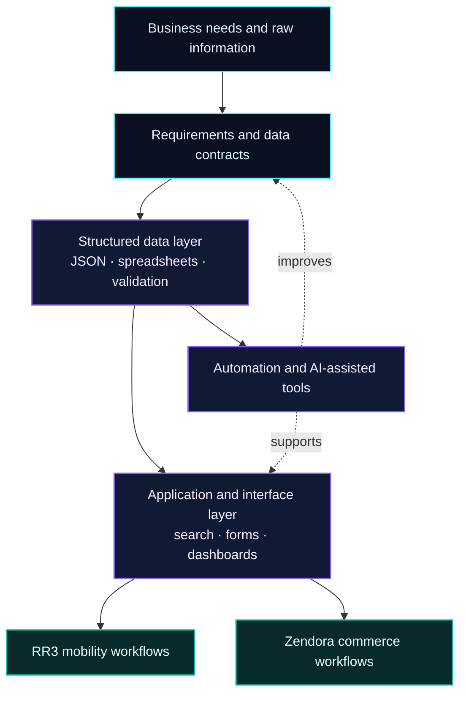

<div align="center">


<h1>RUBAYET KHAN</h1>

<p><strong>SOFTWARE SYSTEMS · DATA-FIRST PRODUCTS · AUTOMATION</strong></p>


<br />

<a href="https://github.com/rubayet9"></a>


<br />

<code>STATUS: BUILDING</code> &nbsp; <code>NODE: BANGLADESH</code> &nbsp; <code>MODE: PRODUCT-MINDED ENGINEERING</code>

</div>

---

## `01 / SYSTEM DOSSIER`

```text
operator@rubayet9:~$ whoami
Rubayet Khan — a product-minded builder focused on useful software,
structured information, practical automation, and clear user experiences.

operator@rubayet9:~$ mission
Turn messy workflows into reliable systems that people can actually use.
```

I enjoy working where **web interfaces, structured data, business workflows, and automation** meet. My focus is not just making a page look good; it is organizing the underlying information and process so the product stays understandable, maintainable, and useful.

| Focus area | What I work toward |
|---|---|
| **Product engineering** | Turning an idea into a clear specification, user flow, and practical implementation plan. |
| **Data systems** | Organizing large, hierarchical datasets so they can be searched, validated, updated, and reused. |
| **Workflow automation** | Reducing repetitive manual work with scripts, integrations, and AI-assisted workflows. |
| **Interface craft** | Building readable, responsive interfaces with intentional layout and visual hierarchy. |

---

## `02 / ACTIVE BUILD DIRECTIVES`

<table>
  <tr>
    <td width="50%" valign="top">
      <h3>🚗 RR3 — Mobility & Vehicle Network</h3>
      <p><strong>A structured vehicle-service ecosystem for Bangladesh.</strong></p>
      <ul>
        <li>Division → district → upazila / area navigation.</li>
        <li>Vehicle-owner, driver, provider, and referral workflows.</li>
        <li>Consistent data schemas for directory and spreadsheet workflows.</li>
      </ul>
      <sub>FOCUS · DIRECTORY DESIGN · DATA QUALITY · OPERATIONS</sub>
    </td>
    <td width="50%" valign="top">
      <h3>🛒 Zendora — Digital Commerce</h3>
      <p><strong>A modular e-commerce product blueprint.</strong></p>
      <ul>
        <li>Catalog, product detail, cart, checkout, and admin flows.</li>
        <li>Reusable UI patterns and explicit product requirements.</li>
        <li>Clear data flow from browsing through order management.</li>
      </ul>
      <sub>FOCUS · PRODUCT SPECS · UI SYSTEMS · STATE & DATA FLOW</sub>
    </td>
  </tr>
  <tr>
    <td width="50%" valign="top">
      <h3>🤖 AI & Workflow Lab</h3>
      <p><strong>Exploring AI-assisted development and automation.</strong></p>
      <ul>
        <li>LLM API and coding-agent workflows.</li>
        <li>MCP-related integrations and tool orchestration.</li>
        <li>Structured extraction, validation, and repeatable tasks.</li>
      </ul>
      <sub>FOCUS · EXPERIMENTS · INTEGRATIONS · AUTOMATION</sub>
    </td>
    <td width="50%" valign="top">
      <h3>📊 Searchable Data Experiences</h3>
      <p><strong>Making structured information easier to use.</strong></p>
      <ul>
        <li>Excel / JSON-friendly data organization.</li>
        <li>Consistent records, deduplication, and predictable fields.</li>
        <li>Fast filtering and straightforward navigation.</li>
      </ul>
      <sub>FOCUS · SCHEMAS · SEARCH · DATA WORKFLOWS</sub>
    </td>
  </tr>
</table>

> These are current areas of work and exploration. Project status and capabilities will evolve as implementation progresses.

---

## `03 / SYSTEM ARCHITECTURE`



### Engineering principles

- **Schema before scale:** define the shape of data before building many screens around it.
- **Simple by default:** avoid unnecessary complexity when a simpler solution is reliable.
- **Validate at boundaries:** treat external inputs and imported data as untrusted until checked.
- **Security is part of the design:** use least privilege, clear access rules, and sensible request limits.
- **Document the decisions:** write down requirements, assumptions, and trade-offs so systems remain maintainable.

---

## `04 / TECH & TOOLING MATRIX`

<div align="center">

**WEB & UI**  


**DATA & INTEGRATION**  


**VERSION CONTROL & AI EXPLORATION**  


</div>

<sub>Badges describe technologies and work areas represented in my current projects; they are not skill ratings.</sub>

---

## `05 / PUBLIC REPOSITORY SIGNALS`

A few public repositories and frontend experiments from my profile:

<table>
  <tr>
    <td width="50%" valign="top">
      <h3><a href="https://github.com/rubayet9/portfolio-web">portfolio-web</a></h3>
      <p>Personal web and portfolio interface work.</p>
      <a href="https://github.com/rubayet9/portfolio-web"></a>
    </td>
    <td width="50%" valign="top">
      <h3><a href="https://github.com/rubayet9/B9A2-Hero-Travel-main">B9A2 — Hero Travel</a></h3>
      <p>Travel-themed frontend practice project.</p>
      <a href="https://github.com/rubayet9/B9A2-Hero-Travel-main"></a>
    </td>
  </tr>
  <tr>
    <td width="50%" valign="top">
      <h3><a href="https://github.com/rubayet9/B9A3-Hockeys-main">B9A3 — Hockeys</a></h3>
      <p>A sports-themed layout and responsive UI exercise.</p>
      <a href="https://github.com/rubayet9/B9A3-Hockeys-main"></a>
    </td>
    <td width="50%" valign="top">
      <h3><a href="https://github.com/rubayet9/g3-architects-resources-main">G3 Architects</a></h3>
      <p>An architecture-themed web design practice project.</p>
      <a href="https://github.com/rubayet9/g3-architects-resources-main"></a>
    </td>
  </tr>
</table>

<div align="center">
  <a href="https://github.com/rubayet9?tab=repositories"></a>
</div>

---

## `06 / LIVE GITHUB TELEMETRY`

<div align="center">
  
  
  <br />
  
</div>

### Contribution animation

<div align="center">
  
</div>

The snake image is generated by the included GitHub Actions workflow. It appears after the workflow runs successfully for the first time.

---

<details>
  <summary><strong>⌁ Expand: system notes and working style</strong></summary>
  <br />

  **How I approach a build**
  1. Define the users, use cases, constraints, and success criteria.
  2. Model the data and permissions before adding complexity.
  3. Build the simplest useful path and test the edge cases.
  4. Document setup, operation, and future improvements.

  **What I value**
  - Useful features over decorative complexity.
  - Transparent data structures over hard-to-maintain shortcuts.
  - Clear naming, predictable flows, and responsive interfaces.
  - Automation that remains understandable and controllable.
</details>

---

<div align="center">

### `07 / ESTABLISH CONNECTION`

**Have a practical idea, a data problem, or a product to build?**  
Explore the repositories or connect through GitHub.

<a href="https://github.com/rubayet9"></a>
<a href="https://github.com/rubayet9?tab=repositories"></a>


<sub>Designed as a living profile — built to evolve alongside the work.</sub>

</div>
